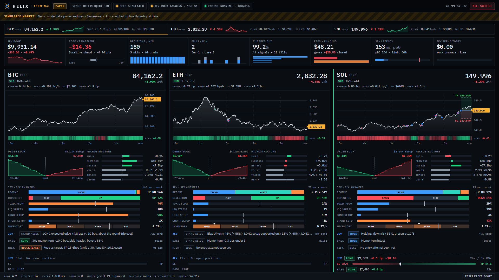
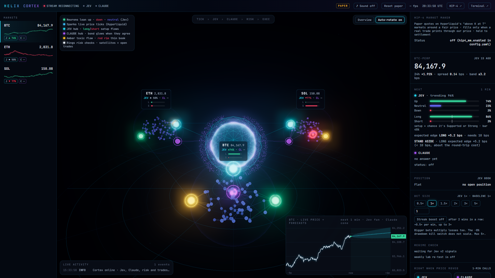
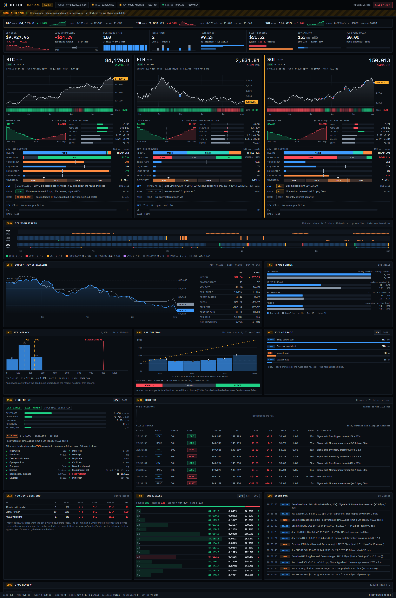

<div align="center">

# HELIX

### See every decision your trading bot makes.

A trading bot and research terminal for [Hyperliquid](https://hyperliquid.xyz).
Live order books in. Every decision, filter and risk check on screen.

**[▶ Open the demo](https://neo111neo.github.io/helix-trading-bot/demo.html)** ·
**[Website](https://neo111neo.github.io/helix-trading-bot/)** ·
**[Download](https://github.com/Neo111Neo/helix-trading-bot/archive/refs/heads/main.zip)**


<a href="https://neo111neo.github.io/helix-trading-bot/demo.html"></a>

<sub>Demo mode: simulated market and mock AI answers. Not real trades or results.</sub>

</div>

## Why HELIX

Most trading bots are black boxes. HELIX shows its work. Open the terminal and you can see what it knew, what it
decided, which check stopped it, and whether the AI beat a simple set of rules paying the same fees.

| | |
|---|---|
| **Live market data** | Order books, trades and funding over WebSocket, with REST backup |
| **AI answers, code decides** | Jev answers typed questions under a deadline. Plain code makes the call |
| **Risk limits AI can't override** | Daily loss, drawdown, data age, spread, slippage, leverage, kill switch |
| **Honest scoring** | Calibration, a trade funnel and a rules baseline on identical data |
| **HIP-4 outcome markets** | Prices contracts like "BTC above K at 19:00" from a volatility model |
| **Research built in** | Tape recorder, replay backtester and a zero-risk strategy lab |
| **Paper first** | No keys or account needed for the demo. Live trading is off by default |

> [!WARNING]
> **The code can trade real money.** The live pilot (`helix/hip4_exec.py`) stays off until you set
> `hip4_live.live_enabled: true`, add wallet keys to `.env`, install the Hyperliquid SDK and pass the go-live gate.
> Read [LIVE_PILOT.md](LIVE_PILOT.md) first.

## Get it running

**Windows:** install Python 3.10 or newer, [download the code](https://github.com/Neo111Neo/helix-trading-bot/archive/refs/heads/main.zip),
run `setup.bat`, then `demo.bat`. Use `start.bat` for live market data with paper trading.

**Mac or Linux:**

```bash
git clone https://github.com/Neo111Neo/helix-trading-bot && cd helix-trading-bot
python3 -m venv .venv && .venv/bin/pip install -r requirements.txt
cp .env.example .env
.venv/bin/python run.py --demo --config config.demo.yaml   # simulated market
.venv/bin/python run.py                                    # live market data, paper trading
```

The terminal opens at http://127.0.0.1:8787.

### HELIX Cortex



<sub>Demo mode, simulated market.</sub>

<details>
<summary><b>See the whole terminal</b></summary>



</details>

## What's inside

- **HIP-4 sniper (main strategy).** Takes quotes at least `snipe_edge` away from model fair value. Sells Yes only by
  default (`hip4_sniper.sides`).
- **HIP-4 market maker.** Included, with quoting paused: it lost money in backtests and on paper.
- **Perpetuals paper engine.** Off in `config.yaml`: every variant tested lost money after costs. On in the demo.
- **Jev (TypeSafe AI) signals and Claude forecasts.** Optional, billed to your own accounts. `jev.daily_budget_usd` and
  `claude_forecast.daily_budget_usd` cap them; the HIP-4 and hourly forecast tests make further calls.

```
run.py                  starts everything
helix/hip4_mm.py        HIP-4 paper strategies (sniper and market maker)
helix/hip4_exec.py      live pilot: sends real orders when enabled
helix/hip4_backtest.py  replay backtests over recorded tape
helix/shadow_lab.py     zero-risk strategy tournament
helix/engine.py         main loop and monitor
helix/risk.py           hard risk checks and sizing
helix/hyperliquid.py    market data
helix/server.py         web terminal server
web/                    terminal pages
lab.py                  Jev prompt lab
pilot_check.py          connection check for the live pilot (--test-order sends one unfillable order)
tests/                  python -m unittest discover -s tests
```

All settings are in `config.yaml`, explained in `helix/config.py`. Secrets go in `.env`, which git ignores. HELIX
refuses to listen on the network unless `HELIX_TOKEN` is set.

## Risk

Experimental software, not financial advice. Nothing here shows a proven edge: paper and backtest results overstate
live results, and you can lose everything you put in. Check that these markets are legal where you live. Not affiliated
with Hyperliquid, TypeSafe AI or Anthropic.
